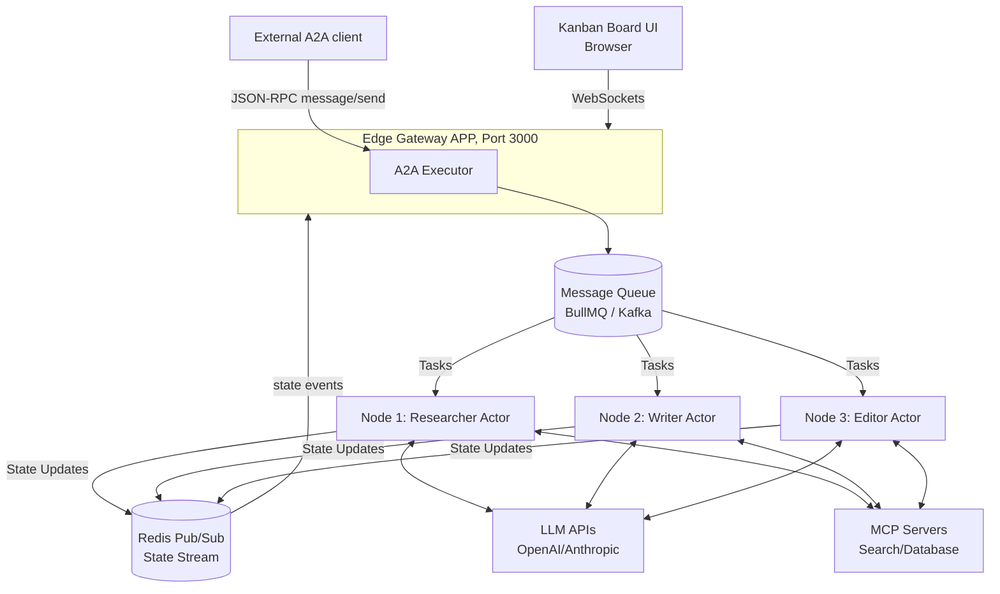
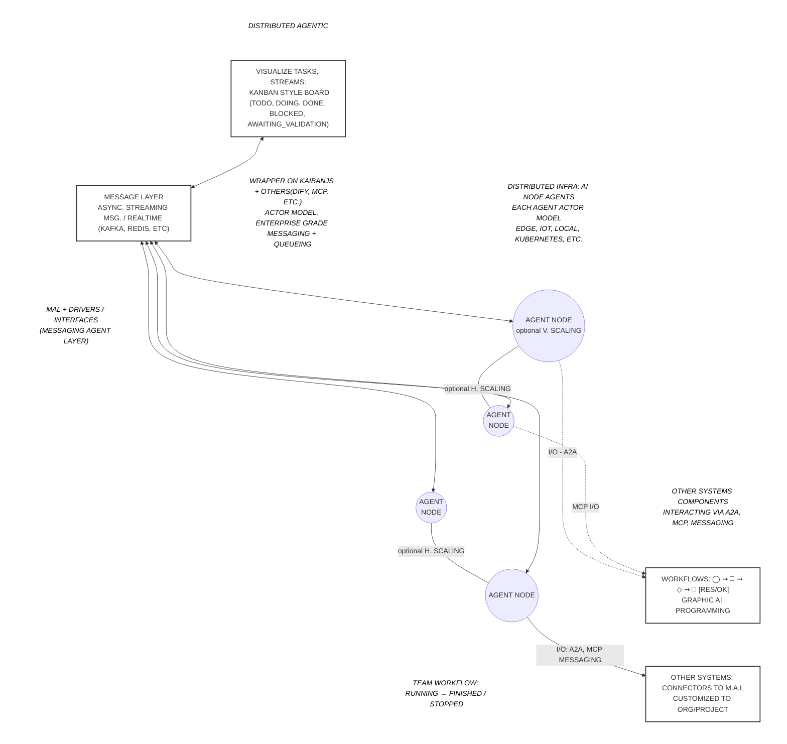

# Architecture views

Extra views of the system. The main container view and the task state machine are in the [README](../../README.md#architecture); the design is explained in [ACTOR_MODEL.md](ACTOR_MODEL.md), the plan and C4 sources in [PLAN.md](PLAN.md).

## Detailed ASCII view (layout, 2.1)

```
┌──────────────────────────────────────────────────────────────────────┐
│  Board Viewers (browser)                                             │
│  A. board/  — React + Vite app  (npm run dev → :5173)                │
│     Interactive HITL: Approve / Revise / Reject buttons              │
│     socket.emit('hitl:decision') ───────────────────────────────┐    │
│  B. examples/blog-team/viewer/board.html  (zero-setup)          │    │
│  Socket.io client ──────────────────────────────────────────────┼────┘
└─────────────────────────────────────────────────────────────────│────┘
                                                                  │ ws
┌─────────────────────────────────────────────────────────────────▼────┐
│  Edge Gateway  (port 3000)                                           │
│  GatewayApp:   GET /health · /ready · /startup                       │
│                GET /.well-known/agent-card.json                      │
│                POST /a2a/rpc  (JSON-RPC 2.0 → routes to queue)       │
│                /mcp (when enabled) · POST /control/stop-all          │
│  CompletionRouter: reads kaiban-events-completed / -failed           │
│  SocketGateway: subscribes Redis kaiban-state-events → Socket.io     │
│                 listens 'hitl:decision' → publishes kaiban-hitl-     │
│                 decisions (Redis) → orchestrator picks up decision   │
│                 'control:stop-all' → kaiban-control (Redis)          │
└──────────────────────────────────────────────────────────────────────┘
         │ BullMQ / Kafka task queues        │ Redis Pub/Sub
         │ kaiban-agents-{agentId}           │ kaiban-state-events
┌────────▼──────────┐  ┌────────▼────────┐  ┌────────▼───────────────┐
│ Worker: researcher│  │ Worker: writer  │  │ Worker: editor         │
│  AgentActor       │  │  AgentActor     │  │  AgentActor            │
│  KaibanAgentBridge│  │  KaibanBridge   │  │  KaibanBridge          │
│  → team.start()   │  │  → team.start() │  │  → team.start()        │
│  AgentState       │  │  AgentState     │  │  AgentState            │
│  Publisher        │  │  Publisher      │  │  Publisher             │
│  (ioredis pub/sub)│  │  (ioredis)      │  │  (ioredis)             │
└───────────────────┘  └─────────────────┘  └────────────────────────┘
         │                      │                        │
         └──────────────────────┴────────────────────────┘
                                │
                    ┌───────────▼────────────┐
                    │  Redis 7 (always)      │
                    │  BullMQ queues +       │
                    │  kaiban-state-events   │
                    └────────────────────────┘

  Redis Pub/Sub channels: kaiban-state-events · kaiban-hitl-decisions ·
  kaiban-control (STOP ALL; every worker and orchestrator holds a
  ControlSubscriber; `npm run stop-all` publishes to it directly)

  Optional: Kafka (MESSAGING_DRIVER=kafka)
┌─────────────────────────────────────────────────────────────────────┐
│  Zookeeper + Kafka — high-throughput alternative to BullMQ          │
│  KafkaDriver implements IMessagingDriver (swap via env var)         │
│  State broadcast still uses Redis Pub/Sub (SocketGateway)           │
└─────────────────────────────────────────────────────────────────────┘
```


## High-Level Distributed Topology Example




### Complete Architectural Schema (Digitalized from Sketch)

Conceptual overview, not a module map. Dify is shown as an example of an external workflow tool; this repository has no Dify code. Task lifecycle in the sketch omits STOPPED (see the state machine in the README).



